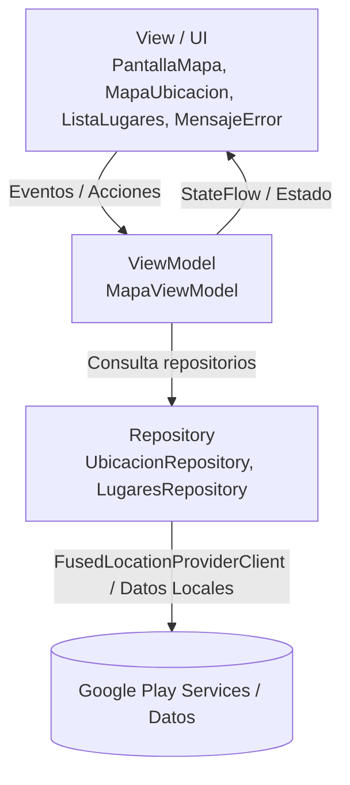
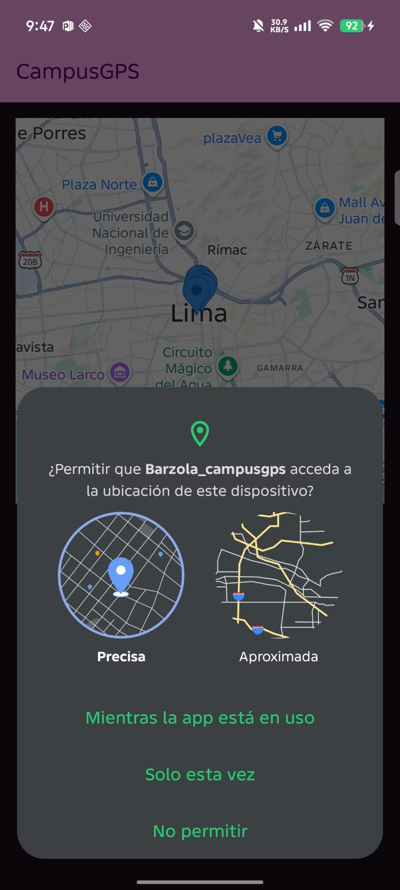
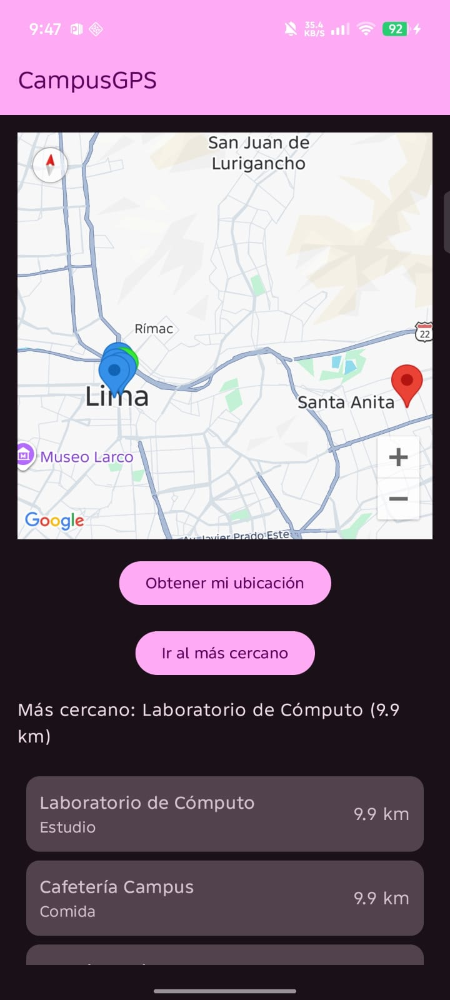
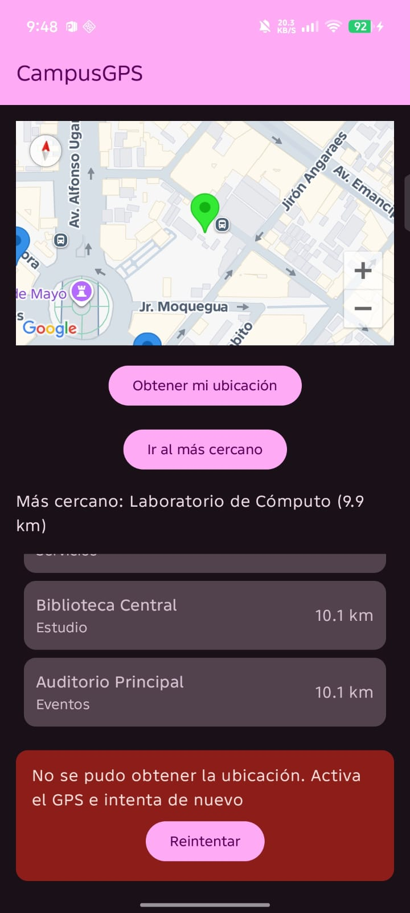

# 📍 CampusGPS

## 📝 Descripción
CampusGPS es una aplicación desarrollada en **Jetpack Compose** para Android que permite a los usuarios ubicarse dentro de un campus universitario mediante **Google Play Services Location** y **Google Maps Compose**. La aplicación calcula la distancia desde la posición actual del usuario hasta los diferentes puntos de interés del campus (biblioteca, cafetería, laboratorios, etc.), ordenándolos de menor a mayor distancia, resaltando el lugar más cercano y manejando de forma robusta los estados de error (como permisos denegados o GPS apagado).

---

## 📂 Árbol de Paquetes
```text
com.tecsup.barzola_campusgps
│
├── data/
│   ├── LugaresRepository.kt
│   ├── LugaresRepositoryLocal.kt
│   ├── UbicacionRepository.kt
│   └── UbicacionRepositoryGoogle.kt
│
├── model/
│   └── Modelos.kt
│
├── ui/
│   ├── ListaLugares.kt
│   ├── MapaUbicacion.kt
│   ├── MensajeError.kt
│   ├── PantallaMapa.kt
│   └── theme/
│       ├── Color.kt
│       ├── Theme.kt
│       └── Type.kt
│
├── util/
│   ├── Distancia.kt
│   └── Formato.kt
│
├── viewmodel/
│   ├── CampusViewModelFactory.kt
│   └── MapaViewModel.kt
│
└── MainActivity.kt
```

---

## 🏛️ Diagrama MVVM


---

## 📱 Capturas de Pantalla

### 1. Solicitud de Permisos


### 2. Mapa con Ubicación Actual


### 3. Marcadores en el Mapa


### 4. Lista Ordenada por Distancia


### 5. Manejo de Estados de Error


### 6. Preguntas para Pensar


---

## 🧠 Para Pensar (Preguntas y Respuestas)

1. **¿Por qué FusedLocationProviderClient está dentro del Repository y no en el ViewModel?**
   - Para separar responsabilidades: el Repository maneja los datos externos y el ViewModel solo la lógica y el estado de la UI, evitando acoplarse al contexto de Android.

2. **¿Qué diferencia hay entre el permiso de ubicación y la clave de API de Maps? ¿Qué pasa si falta cada uno?**
   - El permiso es la autorización del usuario (sin él la app no lee el GPS). La API Key es la credencial de Google (sin ella el mapa sale gris).

3. **¿Por qué la clave va en local.properties y no en el código? ¿Qué harías si se subiera a GitHub por error?**
   - Porque `local.properties` no se sube a Git y evita filtrar claves privadas. Si se filtrara, la revoco inmediatamente en Google Cloud Console y genero otra.

4. **¿Dónde calculas la distancia y por qué no en el Composable?**
   - En el ViewModel y utilidades. La UI (Composable) debe ser puramente declarativa y no debe hacer cálculos pesados de lógica de negocio.

5. **¿Qué pasa con tu app si el usuario niega el permiso dos veces? ¿Cómo lo manejas?**
   - Android ya no muestra el cuadro de diálogo. Lo manejo mostrando un botón de **"Abrir ajustes"** que lo redirige a la configuración del sistema para habilitarlo manualmente.
