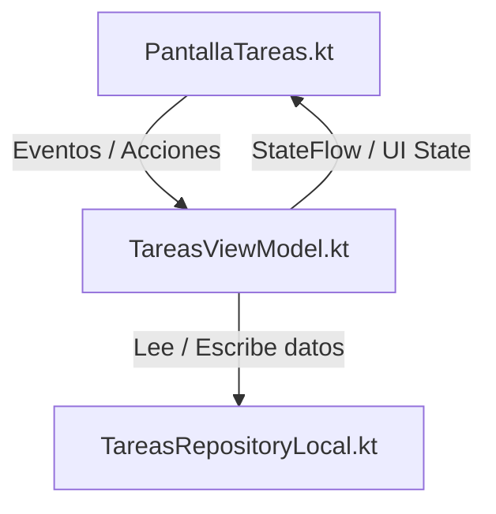

# CentroTareas

Aplicación Android desarrollada en Kotlin, Jetpack Compose y Arquitectura MVVM para practicar el uso de Corrutinas, hilos, flujos (StateFlow) y concurrencia.

---

## 🌳 Árbol de Paquetes

```text
com.tecsup.barzola.centro_de_tareas/
├── data/
│   ├── TareasRepository.kt
│   └── TareasRepositoryLocal.kt
├── model/
│   └── Estados.kt
├── ui/
│   ├── PantallaTareas.kt
│   └── theme/ (Color.kt, Theme.kt, Type.kt)
└── viewmodel/
    ├── TareasViewModel.kt
    └── TareasViewModelFactory.kt
```

---

## 🔄 Diagrama MVVM



---

## 📝 Observación del Paso 1

La primera versión utilizaba `Thread.sleep(4000)` en el hilo principal. Durante esos cuatro segundos, la pantalla quedaba bloqueada y el contador **Tócame** no podía actualizarse visualmente.

El mensaje **Trabajando...** no llegaba a dibujarse porque el mismo hilo encargado de actualizar la pantalla estaba ocupado con la espera. Cuando terminaba el bloqueo, el mensaje cambiaba a **Terminó** y la interfaz volvía a responder.

Si la espera fuera de diez segundos, Android podría mostrar un aviso ANR (*Application Not Responding*, «La aplicación no responde»), según las condiciones y los tiempos de espera del sistema.

---

## 📸 Capturas de Pantalla

### 1. Tarea con Progreso


### 2. Tarea Cancelada


### 3. Contar Números Primos


### 4. Dos Cargas (Una por una vs A la vez)


### 5. Error Simulado y Reintento


---

## 🧠 Para Pensar


