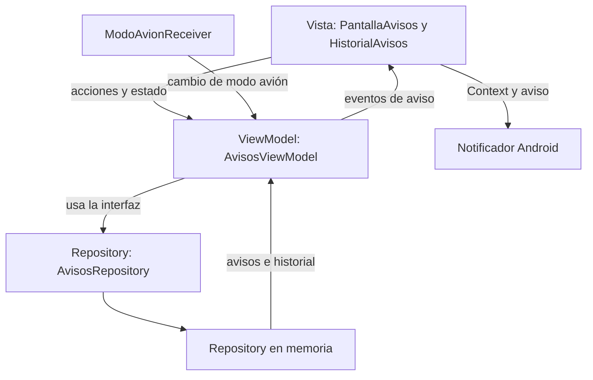
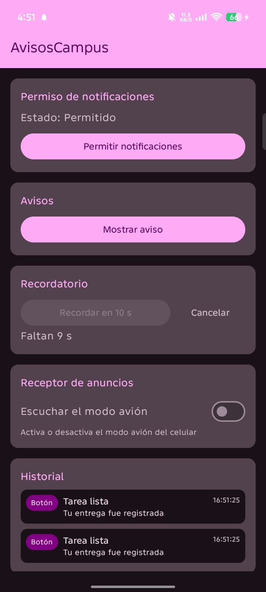
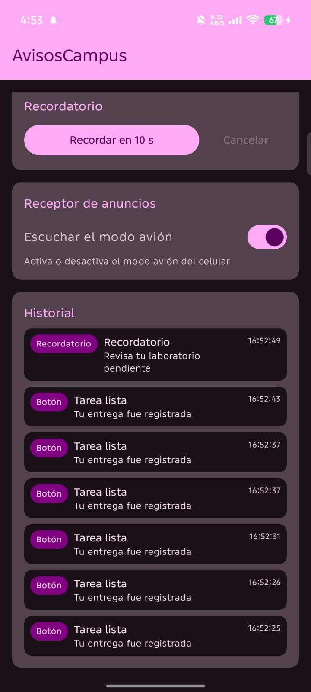

# AvisosCampus

## Descripción

AvisosCampus es una aplicación Android desarrollada con Kotlin y Jetpack Compose. Permite solicitar el permiso de notificaciones, mostrar avisos locales, programar un recordatorio cancelable de diez segundos, escuchar cambios del modo avión y consultar un historial en memoria. La aplicación organiza la lógica con MVVM y Repository.

## Estructura del proyecto

```text
semana 15/
├── app/
│   └── src/main/
│       ├── AndroidManifest.xml
│       ├── java/com/tecsup/comtecsupavisoscampusbarzola/
│       │   ├── AvisosApp.kt
│       │   ├── MainActivity.kt
│       │   ├── data/
│       │   │   └── AvisosRepository.kt
│       │   ├── model/
│       │   │   └── Modelos.kt
│       │   ├── notificacion/
│       │   │   └── Notificador.kt
│       │   ├── receiver/
│       │   │   └── ModoAvionReceiver.kt
│       │   ├── ui/
│       │   │   ├── HistorialAvisos.kt
│       │   │   ├── PantallaAvisos.kt
│       │   │   └── theme/
│       │   └── viewmodel/
│       │       ├── AvisosViewModel.kt
│       │       └── AvisosViewModelFactory.kt
│       └── imagnes/
│           ├── historial.jpeg
│           ├── modo avion.jpeg
│           ├── notificacion en el panel.jpeg
│           ├── permiso denegado.jpeg
│           └── recordatorio.jpeg
├── build.gradle.kts
└── settings.gradle.kts
```

## Arquitectura MVVM



El ViewModel decide qué aviso registrar y emite un evento. La pantalla recibe el evento y llama al notificador porque es la capa que dispone de `Context`. El receptor del modo avión informa el cambio al ViewModel y se desregistra cuando deja de estar activo.

## Capturas

Las imágenes están guardadas en `app/imagnes`.

### Notificación en el panel


### Recordatorio



### Modo avión


### Historial



### Permiso denegado


## Respuestas para pensar

### 1. ¿Por qué una notificación necesita un canal y un permiso? ¿Qué pasa si falta cada uno?

Desde Android 8, cada notificación debe pertenecer a un canal. El canal agrupa las notificaciones y permite que la persona ajuste su importancia o las desactive. Sin un canal válido, Android no puede publicar la notificación en versiones que requieren canales. Desde Android 13, la aplicación también necesita el permiso `POST_NOTIFICATIONS`. Si la persona lo deniega, la app puede seguir registrando el aviso en el historial, pero Android no muestra la notificación.

### 2. ¿Por qué el ViewModel emite un evento y no muestra la notificación él mismo?

El ViewModel mantiene la lógica de presentación y no debe depender de `Context` ni de las APIs del sistema. Emite un evento con los datos del aviso y la pantalla, que sí tiene acceso al contexto, llama al notificador. Así se mantienen separadas la lógica de la app y la interacción con Android.

### 3. ¿Qué pasa si usas el mismo ID en dos notificaciones?

Android identifica una notificación por la combinación usada al publicarla, incluido su ID. Si se vuelve a publicar con el mismo ID, la nueva notificación actualiza o reemplaza la anterior. Usar el ID único del aviso permite que cada notificación permanezca por separado.

### 4. ¿Por qué `onReceive` debe ser corto y por qué hay que quitar el receptor al salir?

`onReceive` se ejecuta en el hilo principal y tiene un tiempo limitado, por eso solo debe leer la acción y enviar el cambio al ViewModel. El receptor dinámico debe desregistrarse al salir de la pantalla o al desactivar la escucha para evitar mantener una referencia a la pantalla y recibir eventos cuando ya no se necesitan.

### 5. ¿En qué casos usarías una notificación local y en cuáles una push de Firebase?

Usaría una notificación local para eventos que la app puede determinar en el dispositivo, como un recordatorio programado o un cambio del modo avión. Usaría una notificación push de Firebase cuando un servidor necesite avisar al dispositivo, por ejemplo ante un mensaje nuevo o una actualización de una cuenta, incluso si la app no está abierta.
