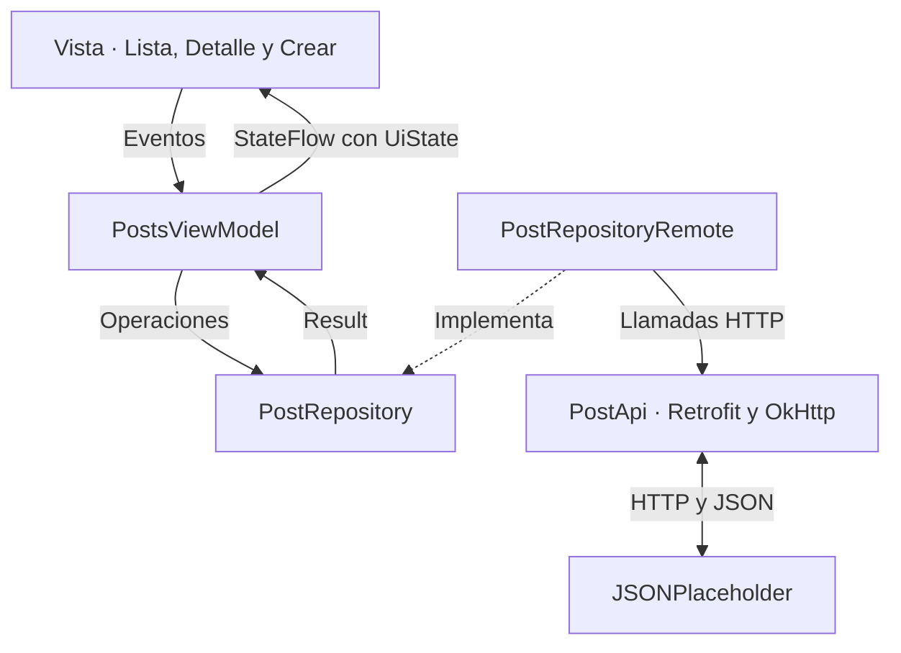
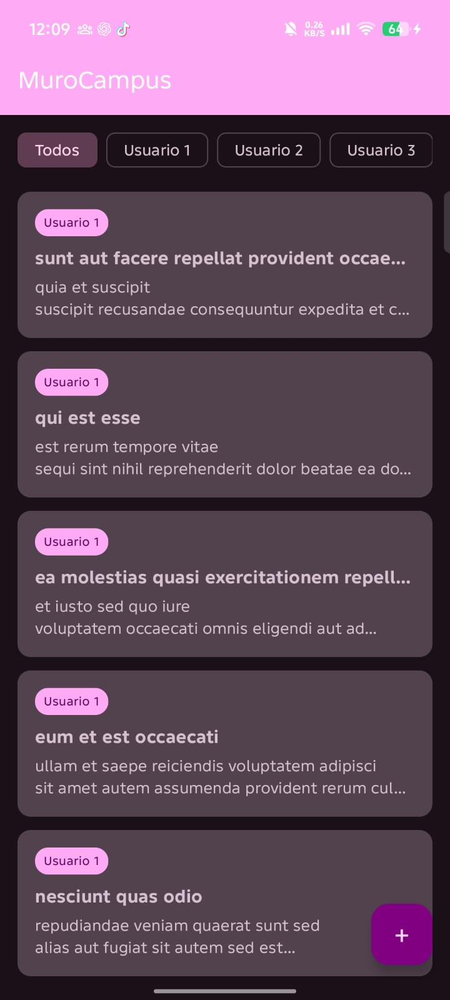
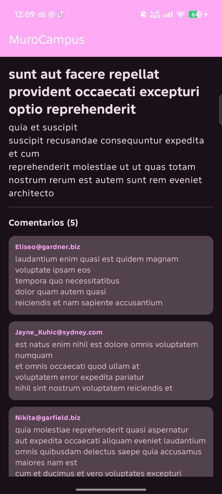
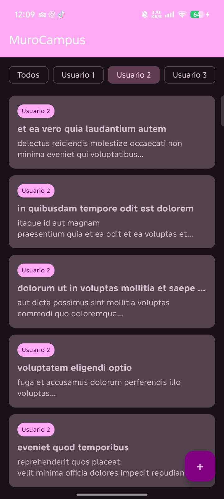
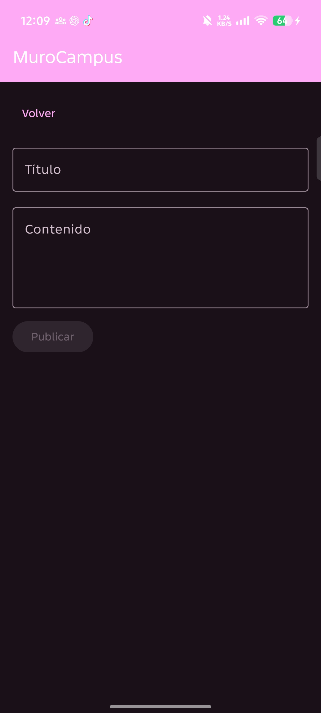
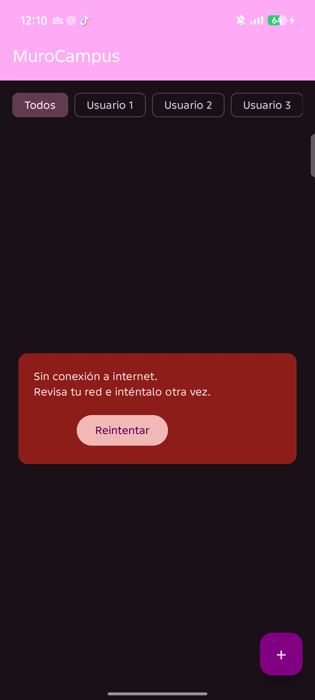

# MuroCampus

MuroCampus es una app Android en Kotlin y Jetpack Compose para consultar publicaciones de JSONPlaceholder. Permite ver el detalle y los comentarios, filtrar por usuario y enviar una publicación de prueba. Si falla la conexión, muestra un error y permite reintentar. JSONPlaceholder simula la creación mediante POST.

## Árbol de paquetes

```text
com.tecsup.comtecsupmurocampusbarzola/
├── MainActivity.kt
├── model/
│   └── Modelos.kt
├── data/
│   ├── PostRepository.kt
│   ├── UsuarioRepository.kt
│   └── remote/
│       ├── PostApi.kt
│       ├── RetrofitClient.kt
│       └── UsuarioApi.kt
├── viewmodel/
│   ├── PostsViewModel.kt
│   ├── PostsViewModelFactory.kt
│   └── UiState.kt
└── ui/
    ├── Componentes.kt
    ├── PantallaLista.kt
    ├── PantallaDetalle.kt
    ├── PantallaCrear.kt
    └── theme/
        ├── Color.kt
        ├── Theme.kt
        └── Type.kt
```

## Diagrama MVVM



## Capturas

| Lista | Detalle | Filtro |
| :---: | :---: | :---: |
|  |  |  |

| Crear publicación | Error de conexión |
| :---: | :---: |
|  |  |

## Para pensar

[Captura de las preguntas de la guía](app/imagenes/para%20pensar.png)

1. **¿Qué diferencia hay entre GET y POST?** GET consulta datos y POST envía datos para crear un recurso. `@Body` envía la publicación en el cuerpo de la solicitud y `@Query` pone el filtro en la URL, como `?userId=2`.
2. **¿Por qué se usa `posts`?** Es una ruta relativa que se agrega a la URL base. `/posts` parte de la raíz del dominio y reemplaza cualquier ruta de la base.
3. **¿Por qué el Repository devuelve `Result`?** El ViewModel recibe el éxito o el fallo y lo convierte en un estado de pantalla sin manejar directamente las excepciones de red.
4. **¿Qué pasa sin `INTERNET` o `ignoreUnknownKeys`?** Sin el permiso, la app no puede hacer peticiones de red. Sin esa opción, un campo extra en el JSON puede causar un error de deserialización.
5. **¿Por qué usar `when` sobre `UiState`?** La pantalla tiene un solo estado a la vez. `when` cubre carga, éxito y error sin usar variables independientes que puedan contradecirse.
6. **¿Qué cambiaría con un servicio real?** El servidor guardaría la publicación. Tras el POST, la app podría añadir la publicación devuelta o recargar la lista para mostrarla.
